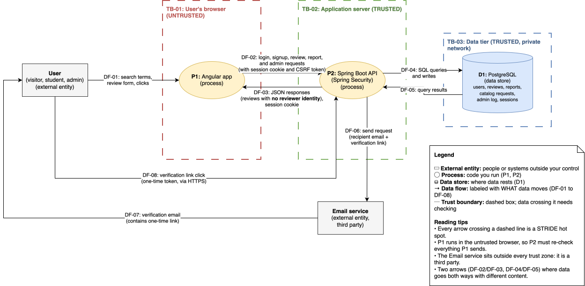

# Threat Model: Brick Reviews

|                        |                                             |
| ---------------------- | ------------------------------------------- |
| **Author**       | Dylan Ramdath                               |
| **Last updated** | 2026-11-02                                  |
| **Version**      | 1.0                                         |
| **Method**       | STRIDE-per-element, Four Question Framework |

Related: [Product Brief](product-brief.md) · [User Stories](user-stories.md) · [Domain Model](domain-model.drawio.svg)

## 1. System Overview

Brick Reviews is a web app where verified RIT students review courses and the professors who taught them. Anyone can access reviews about a course or professor. Students must sign up using an @rit.edu email address and verify their email before they can contribute. Verified students can write, edit, and delete their own reviews, and can report a review on the website. Admins moderate reported reviews, deleting reviews and banning users when necessary, and manage the course and professor catalog, including approving or rejecting catalog requests.

The application stores a user's email address, password hash (Argon2id), reviews, reports, catalog requests, and admin action logs. The most sensitive data is the link between a review and the account that wrote it, since reviews are shown publicly as anonymous. An Angular frontend is served from the same origin as a Spring Boot REST API, which uses Spring Security with server-side sessions (HttpOnly cookies, stored via Spring Session JDBC) and stores data in PostgreSQL. A third-party email service sends verification emails.

**In scope:** the frontend, API, database, and email integration as designed for v1. **Out of scope:** the hosting provider's infrastructure, the email provider's internal security, and RIT's mail servers.

## 2. Assets

| ID   | Asset                                                                                    | Why it matters (who is hurt if compromised)                                                                               |
| ---- | ---------------------------------------------------------------------------------------- | ------------------------------------------------------------------------------------------------------------------------- |
| A-01 | Reviewer identity (which account wrote which review)                                     | If leaked, a professor could learn which student criticized them; students would stop writing honest reviews              |
| A-02 | User accounts and credentials (passwords, sessions)                                      | A taken-over account could have its reviews tampered with or deleted; reused passwords could expose users' other accounts |
| A-03 | Admin privileges                                                                         | Anyone with them could delete fair reviews, ban students, or vandalize the catalog                                        |
| A-04 | Review integrity (scores and text are genuine and unaltered, one per student per course) | Fake, duplicated, or altered reviews would make every rating untrustworthy, defeating the app's purpose                   |
| A-05 | Availability of the site and its data                                                    | If the site is down or data is lost, students can't read or write reviews and the app provides no value                   |

## 3. Data Flow Diagram (DFD)

### 3.1 Elements

| ID   | Element                                           | Type            | STRIDE categories that apply |
| ---- | ------------------------------------------------- | --------------- | ---------------------------- |
| E-01 | User (visitor, student, admin)                    | External entity | S, R                         |
| E-02 | Email service                                     | External entity | S, R                         |
| E-03 | P1: Angular app                                   | Process         | S, T, R, I, D, E             |
| E-04 | P2: Spring Boot API                               | Process         | S, T, R, I, D, E             |
| E-05 | D1: PostgreSQL                                    | Data store      | T, R, I, D                   |
| E-06 | DF-01: User → Angular app                        | Data flow       | T, I, D                      |
| E-07 | DF-02 / DF-03: Angular app ↔ API                 | Data flow       | T, I, D                      |
| E-08 | DF-04 / DF-05: API ↔ PostgreSQL                  | Data flow       | T, I, D                      |
| E-09 | DF-06: API → Email service                       | Data flow       | T, I, D                      |
| E-10 | DF-07: Email service → User (verification email) | Data flow       | T, I, D                      |
| E-11 | DF-08: User → API (verification link click)      | Data flow       | T, I, D                      |

PostgreSQL includes Repudiation because it stores the admin action log.

### 3.2 Trust Boundaries

| ID    | Boundary                             | What crosses it                                                                                       |
| ----- | ------------------------------------ | ----------------------------------------------------------------------------------------------------- |
| TB-01 | User's browser (untrusted)           | DF-01 (user input into the Angular app); DF-02 and DF-03 (requests and responses leaving the browser) |
| TB-02 | Application server (trusted)         | DF-02, DF-03, and DF-08 from the internet; DF-06 out to the third-party email service                 |
| TB-03 | Data tier (trusted, private network) | DF-04 and DF-05 (queries and results between the API and PostgreSQL)                                  |

The email service sits outside every trust zone because it is a third party.

---

## 4. STRIDE Analysis

| ID   | Element                  | STRIDE | Threat                                                                                                                      | Related                         |
| ---- | ------------------------ | ------ | --------------------------------------------------------------------------------------------------------------------------- | ------------------------------- |
| T-01 | E-04 P2: Spring Boot API | E      | A regular student calls admin endpoints directly to retire courses or ban users                                             | AC-03                           |
| T-02 | E-01 User                | S      | An attacker guesses or reuses a student's password to log in as them                                                        | AC-02                           |
| T-03 | E-01 User                | S      | A banned user keeps using an old session or signs up again with the same email                                              | AC-10                           |
| T-04 | E-01 User                | S      | Someone signs up using another student's @rit.edu address                                                                   | US-01, US-02                    |
| T-05 | E-01 User                | S      | A verified student reviews a course they never took                                                                         | Brief §9                       |
| T-06 | E-01 User                | R      | A student posts a harassing review and later denies writing it                                                              | US-14, US-19                    |
| T-07 | E-02 Email service       | S      | An attacker sends phishing emails that imitate Brick Reviews verification emails to steal passwords                         | US-02                           |
| T-08 | E-03 P1: Angular app     | T      | An attacker edits the frontend code or skips the UI to send invalid data (e.g., a score of 99 or a 50,000-character review) | US-14, US-15                    |
| T-09 | E-03 P1: Angular app     | I      | Session data stored in browser storage is read by a malicious script                                                        | US-03                           |
| T-10 | E-03 P1: Angular app     | E      | A script inside a review runs in other users' browsers and acts on their behalf (XSS)                                       | AC-07                           |
| T-11 | E-04 P2: Spring Boot API | T      | A student edits or deletes another student's review by changing the review ID in the request                                | AC-05                           |
| T-12 | E-04 P2: Spring Boot API | T      | A student posts several reviews for the same course by calling the API directly                                             | AC-08                           |
| T-13 | E-04 P2: Spring Boot API | T      | An attacker injects SQL through search or form fields                                                                       | AC-04                           |
| T-14 | E-04 P2: Spring Boot API | T      | A malicious website makes a logged-in student's browser submit a review, report, or account deletion (CSRF)                 | New: AC-12                      |
| T-15 | E-04 P2: Spring Boot API | S      | An attacker steals or fixes a session ID to take over a logged-in account                                                   | New: AC-13                      |
| T-16 | E-04 P2: Spring Boot API | R      | An admin removes a fair review or bans a student and later denies doing it                                                  | US-20, US-21, US-22, New: AC-11 |
| T-17 | E-04 P2: Spring Boot API | I      | API responses expose a reviewer's email or user ID                                                                          | AC-06                           |
| T-18 | E-04 P2: Spring Boot API | I      | Signup, resend, or login responses reveal whether an email has an account                                                   | AC-01, US-22                    |
| T-19 | E-04 P2: Spring Boot API | I      | Error responses expose stack traces, SQL, or internal details                                                               | Config                          |
| T-20 | E-04 P2: Spring Boot API | D      | An attacker floods login, signup, search, or review endpoints                                                               | AC-02, AC-04                    |
| T-21 | E-04 P2: Spring Boot API | D      | An attacker mass-reports fair reviews to flood the moderation queue or get them removed                                     | AC-09                           |
| T-22 | E-05 D1: PostgreSQL      | I      | The database or a backup is reachable from the internet and leaks emails, password hashes, and review authorship            | Config                          |
| T-23 | E-05 D1: PostgreSQL      | T, R   | Admin log entries are edited or deleted to hide an action                                                                   | New: AC-11                      |
| T-24 | E-05 D1: PostgreSQL      | D      | Data is lost through server failure or a bad migration, with no backup                                                      | Config                          |
| T-25 | E-06 DF-01               | T, I   | Malware or a malicious browser extension on the user's device reads or changes what they type                               | Out of scope                    |
| T-26 | E-07 DF-02 / DF-03       | T, I   | Traffic on public or campus Wi-Fi is intercepted, exposing passwords and session cookies or altering requests               | Config                          |
| T-27 | E-08 DF-04 / DF-05       | I      | Database credentials are committed to GitHub or the database connection is unencrypted                                      | Config                          |
| T-28 | E-09 DF-06               | I      | The email provider's API key leaks, letting an attacker send email as Brick Reviews                                         | Config                          |
| T-29 | E-10 DF-07 / E-11 DF-08  | S, T   | A verification link is guessed, reused, or used after it expires                                                            | US-02, New: AC-14               |
| T-30 | E-10 DF-07               | I      | Someone else sees a verification email (forwarded or on a shared device) and uses the link                                  | US-02                           |

---

## 5. Responses and Priority

| Threat | Response | Mitigation                                                                                                                                    | Likelihood | Impact | Priority | Tracked in                        |
| ------ | -------- | --------------------------------------------------------------------------------------------------------------------------------------------- | ---------- | ------ | -------- | --------------------------------- |
| T-01   | Mitigate | Every admin endpoint checks the ADMIN role on the server (deny by default); returns 403                                                       | Medium     | High   | High     | AC-03, US-05–US-11, US-19–US-22 |
| T-02   | Mitigate | Argon2id hashing, 12+ character passwords that aren't common, login rate limiting, and temporary lockout after repeated failures              | High       | High   | High     | AC-02, US-01, US-03               |
| T-03   | Mitigate | Banning ends all of the user's sessions; banned accounts can't log in; banned emails can't sign up again                                      | Medium     | Medium | Medium   | AC-10, US-22                      |
| T-04   | Mitigate | Accounts can't post until the email owner clicks a verification link sent to that address                                                     | Medium     | High   | High     | US-01, US-02                      |
| T-05   | Accept   | One review per course, reporting, and moderation limit the damage                                                                             | Medium     | Medium | Medium   | Section 6                         |
| T-06   | Mitigate | Every review is stored with its author's account; admins can see authorship for moderation                                                    | Medium     | Medium | Medium   | US-19                             |
| T-07   | Transfer | Email provider's sender authentication (SPF, DKIM); emails never ask for a password and link only to the app's own domain                     | Low        | Medium | Medium   | Config, Section 6                 |
| T-08   | Mitigate | The API validates every request (Bean Validation: score 1–5, 2,000-character limit, required fields); frontend checks are for usability only | High       | Medium | High     | US-14, US-15                      |
| T-09   | Mitigate | Sessions are kept only in HttpOnly cookies, never in localStorage or sessionStorage                                                           | Low        | High   | High     | US-03, Config                     |
| T-10   | Mitigate | Review text is always rendered as plain text (Angular's default escaping, no `innerHTML`); Content Security Policy header                   | Medium     | High   | High     | AC-07, US-17                      |
| T-11   | Mitigate | The service layer checks that the logged-in user owns the review before any edit or delete; returns 403                                       | Medium     | High   | High     | AC-05, US-15, US-16               |
| T-12   | Mitigate | Unique database constraint on (user, course); review posting is rate limited                                                                  | Medium     | High   | High     | AC-08, US-14                      |
| T-13   | Mitigate | Parameterized queries only (Spring Data JPA); maximum input length on search                                                                  | Medium     | High   | High     | AC-04                             |
| T-14   | Mitigate | Spring Security CSRF protection on all state-changing requests; SameSite=Lax session cookie                                                   | Medium     | High   | High     | AC-12 (new)                       |
| T-15   | Mitigate | Session ID regenerated on login; cookies are HttpOnly, Secure, and SameSite; sessions expire after inactivity and end on logout               | Low        | High   | High     | AC-13 (new), US-03, US-04         |
| T-16   | Mitigate | Every admin action is recorded in the admin log with the admin, time, action, and reason                                                      | Low        | Medium | Medium   | AC-11 (new), US-20–US-22         |
| T-17   | Mitigate | Review DTOs never include reviewer email or user ID; security tests check every review response                                               | Medium     | High   | High     | AC-06, US-14, US-17               |
| T-18   | Mitigate | Identical messages whether or not an account exists; account-specific messages only after a correct password                                  | Medium     | Medium | Medium   | AC-01, US-01–US-03, US-22        |
| T-19   | Mitigate | Global error handler (`@ControllerAdvice`) returns generic messages; stack traces only in server logs                                       | Medium     | Medium | Medium   | Config                            |
| T-20   | Mitigate | Rate limits on login, signup, resend, search, review, and report endpoints                                                                    | Medium     | Medium | Medium   | AC-02, AC-04                      |
| T-21   | Mitigate | Only verified students can report; one report per user per review; reporting is rate limited; an admin always decides                         | Medium     | Medium | Medium   | AC-09, US-18, US-19               |
| T-22   | Mitigate | Database on a private network, not publicly reachable; least-privilege database user; backups encrypted and access-restricted                 | Low        | High   | High     | Config                            |
| T-23   | Mitigate | Admin log is append-only for the application's database user (insert and read, no update or delete)                                           | Low        | Medium | Medium   | AC-11 (new), Config               |
| T-24   | Mitigate | Automated backups from the managed database provider; Flyway migrations tested in CI before deployment                                        | Low        | High   | High     | Config                            |
| T-25   | Accept   | The user's own device is outside the app's control                                                                                            | Low        | Medium | Low      | Section 6                         |
| T-26   | Mitigate | HTTPS only with HSTS; Secure cookie flag                                                                                                      | Medium     | High   | High     | Config                            |
| T-27   | Mitigate | Credentials stored in environment variables or a secrets manager; GitHub secret scanning; SSL required for database connections               | Medium     | High   | High     | Config                            |
| T-28   | Mitigate | Email API key stored as a secret, never in source code; key limited to sending only                                                           | Low        | Medium | Medium   | Config                            |
| T-29   | Mitigate | Verification tokens are long and random, stored hashed, expire after 24 hours, work once, and are invalidated when a new link is sent         | Low        | High   | High     | AC-14 (new), US-02                |
| T-30   | Accept   | Single-use, 24-hour links limit exposure; the email inbox's security is outside the app's control                                             | Low        | Medium | Low      | US-02, Section 6                  |

## 6. Residual Risks (Accepted)

| Threat | Risk                                                                   | Why it's accepted                                                                                          | Revisit when                                                  |
| ------ | ---------------------------------------------------------------------- | ---------------------------------------------------------------------------------------------------------- | ------------------------------------------------------------- |
| T-05   | A verified student reviews a course they never took                    | The app cannot verify enrollment without access to RIT records, which is out of scope                      | If RIT ever offers an official enrollment check               |
| T-07   | Phishing emails imitating Brick Reviews                                | The app cannot stop third parties from sending email; sender authentication reduces but doesn't prevent it | If phishing attempts are reported by users                    |
| T-25   | Malware or malicious extensions on a user's device                     | The user's device is outside the app's control                                                             | No planned change                                             |
| T-30   | Someone else uses a verification link from a forwarded or shared email | Inbox security is outside the app's control; single-use, short-lived links limit the damage                | If verification abuse is reported                             |
| —     | Hosting provider or email provider is compromised                      | Third-party infrastructure is out of scope; reputable providers are used                                   | When choosing or changing providers                           |
| —     | Verification emails are blocked or filtered by RIT's mail system       | RIT's mail servers are out of the app's control                                                            | Test with a real @rit.edu address during the walking skeleton |

---

## 8. Revision History

| Date       | Version | Change               |
| ---------- | ------- | -------------------- |
| 2026-11-02 | 1.0     | Initial threat model |
